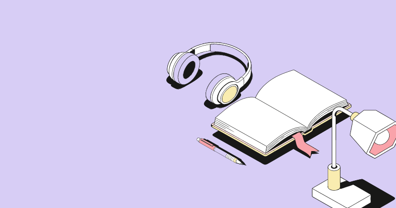

# SVG Illustration Composer

Веб-сервис, который собирает иллюстрации из готовых векторных объектов библиотеки — по метафоре/заголовку или по списку компонентов — и отдаёт чистый редактируемый SVG.

**Демо:** https://super-cloud0.github.io/svg-illustration-composer/



## Что умеет

- **Сценарий 1 — метафора.** Вводите «учёба и концентрация» или «финансовая грамотность» — сервис подбирает 2–5 объектов по словарю синонимов и показывает, *почему* выбран каждый объект. Опционально — AI-подбор через Groq (`llama-3.3-70b-versatile`): модель только возвращает ID объектов из `library.json`, изображения не генерируются.
- **Сценарий 2 — компоненты.** «книга, наушники, лампа», «кошелёк, 2 монеты», «фоновая лампа» — объекты раскладываются автоматически; неизвестные названия подсвечиваются.
- **Автокомпоновка** по трём шаблонам из Figma: «Под заголовок» (объекты справа/снизу, слева сверху — зона для заголовка), «Со смещением» (кластер смещён к краю и частично выходит за кадр), «Собранно» (компактно по центру). Кнопка «Перемешать» даёт другие варианты раскладки.
- **Форматы:** 1200×630, 1200×1200, 1080×1350, 1000×1000, 800×1200 и произвольный размер.
- **Размеры L / S** — переключение подгружает соответствующий набор объектов (разная детализация), композиция сохраняется.
- **Редактор (SVG-холст):** выделение, перетаскивание, поворот (маркер, слайдер, `R`), дублирование, удаление, порядок слоёв, переключение «главный ↔ фоновый», undo/redo, горячие клавиши. Выход объектов за кадр виден приглушённо — как в Figma.
- **Палитры:** фиолетовая, персиковая, бирюзовая (JSON в `src/data/palettes`) + загрузка своей палитры JSON с автоматической перекраской всей композиции и фона. Есть кнопка «скачать шаблон палитры».
- **Декор фона** (конфетти, волна) из библиотеки — тоже перекрашивается палитрой.
- **Экспорт:** «Скачать SVG» и «Копировать SVG». Каждый объект — именованная группа `<g id="lamp-1" transform="…">` с исходными путями.
- **Свои SVG:** загрузка в библиотеку из интерфейса (очищаются от скриптов, id префиксуются).

### Горячие клавиши

| Клавиша | Действие |
|---|---|
| `Del` / `Backspace` | удалить |
| `Ctrl+D` | дублировать |
| `Ctrl+Z` / `Ctrl+Shift+Z`, `Ctrl+Y` | отменить / повторить |
| `[` / `]` | слой назад / вперёд (`Ctrl` — на задний / передний план) |
| `R` / `Shift+R` | поворот ±15° (при перетаскивании маркера `Shift` — шаг 15°) |
| `B` | главный ↔ фоновый вариант |
| стрелки (`Shift` ×10) | сдвиг |
| `Esc` | снять выделение |

## Правила, которые соблюдает сервис

Объект **никогда** не меняется: к нему применяется только `translate + rotate + scale`, где `scale` — **один коэффициент на всю композицию**. Поэтому пропорции объектов относительно друг друга сохраняются; это проверяется тестом, который сравнивает атрибуты `d` всех путей в экспорте с исходными файлами байт-в-байт. Перекраска меняет только значения `fill` / `stroke` по таблице «исходный цвет → цвет схемы», так что цветовая схема не нарушается. Результат — всегда вектор, без растра.

Для сравнения: во фреймах «SVG-drop» из Figma объекты одной композиции масштабированы по-разному (лампа ×0.26, ручка ×0.59), а в «Примерах композиций» дизайнера все объекты в масштабе ×1.00. Сервис следует примерам дизайнера (см. `reference/README.md`).

## Запуск

Нужен Node.js 20+.

```bash
npm install
npm run dev        # http://localhost:5173 (перед стартом пересобирает library.json)
npm test           # unit-тесты (vitest)
npm run build      # production-сборка в dist/
npm run examples   # пересобрать examples/*.svg и *.png
```

Деплой — GitHub Actions (`.github/workflows/deploy.yml`) на GitHub Pages при пуше в `main`.

## Архитектура

```
assets/                 исходные SVG из Figma: {L|S}_{main|bg}_{object}.svg (40 шт.) + decor/
scripts/
  figma-export.mjs      экспорт ассетов через Figma REST API (токен из .env)
  build-library.ts      индексатор: assets/ → src/data/library.json + public/library/
  rebuild-references.ts референсные композиции из координат узлов Figma
  make-examples.ts      примеры тем же кодом, что и приложение (+ PNG через resvg)
src/core/               чистая логика без DOM — общая для браузера, скриптов и тестов
  svg.ts                парсинг SVG, нормализация цветов, санитизация загрузок
  recolor.ts            перекраска по таблице цветов, разбор JSON-палитры
  matching.ts           сценарии 1 и 2: словарь синонимов, разбор списка компонентов
  llm.ts                опциональный запрос к Groq, валидация ID по библиотеке
  layout.ts             автокомпоновка по шаблонам
  export.ts             сборка итогового SVG
src/data/               catalog.json (названия, теги), synonyms.json, palettes/*.json, library.json
src/state/              история undo/redo, загрузка библиотеки и пользовательских SVG
src/components/         Canvas (SVG-редактор), панели сценариев, библиотеки, инспектор
```

### Хранение

Исходники — отдельные SVG-файлы в `assets/`, по одному на объект × размер × вариант (`L_main_book.svg`, `S_bg_headphones.svg`). Они выгружены из страницы «Библиотека компонентов» через Figma REST API (`scripts/figma-export.mjs`) без изменений; единственная обработка — у книги L в Figma одна маленькая деталь лежит вне группы, она вставлена в тот же файл с исходным смещением.

### Парсинг и индексация

`scripts/build-library.ts` на этапе сборки читает каждый файл, достаёт `viewBox`, собирает множество цветов `fill`/`stroke` и пишет запись в `src/data/library.json`: `id`, `key`, название (ru/en), размер `L|S`, тип `main|bg`, габариты, теги на русском и английском (из `catalog.json`), использованные цвета. Там же вычисляется исходная палитра библиотеки (ровно 8 цветов фиолетовой схемы) и единый коэффициент набора S (медиана отношений L/S ≈ 2), чтобы при переключении L ↔ S композиция сохраняла размеры без искажения пропорций внутри набора. Сами файлы копируются в `public/library/` как есть.

### Переиспользование

В браузере файлы загружаются один раз и разбираются на `viewBox` + внутреннюю разметку (`parseSvg`). Композиция хранит только ссылки: `{ key, variant, x, y, rotation }` и общий `scale`. При рендере и экспорте внутренняя разметка исходника вставляется в `<g transform="translate(x y) rotate(r) scale(s) translate(-cx -cy)">`. Дубликат — это ещё одна ссылка на тот же исходник; переключение главный/фоновый или L/S — смена ссылки.

### Перекраска

Палитра — это JSON `{ background, map: { "#исходный": "#целевой" } }` (или `roles: { bgLight, bgMid, bgDark, accent1..3, ink, paper }`). Встроенные схемы получены из образцов цветов на странице библиотеки в Figma. `recolorMarkup` заменяет только значения цветовых атрибутов и `style`-деклараций; геометрия, `fill="none"`, `fill-rule` и прочее не трогаются. Результат кэшируется по `файл + палитра`. Цвет холста берётся из `background` палитры, декор фона перекрашивается той же таблицей.

### Подбор объектов (сценарий 1)

1. Нормализация фразы (регистр, «ё»), грубый стемминг по префиксу.
2. Прямые названия объектов (`catalog.json`) — вес 3; темы из `synonyms.json` («концентрация» → наушники, лампа; «деньги» → кошелёк, монета …) — вес 2 / 1.
3. Если объектов меньше двух — добавляются «компаньоны» (книга → лампа, ручка); если совпадений нет — универсальный набор.
4. Как в примерах дизайнера: крупный второстепенный объект (в 2.5+ раза больше медианы) ставится фоновым вариантом, чтобы не перекрывать главные.
5. Для каждого объекта сохраняется причина выбора — она показывается в интерфейсе.

AI-режим (Groq) получает список `id` объектов текущего размера с тегами и должен вернуть JSON `{objects:[{id, reason}]}`; все `id`, которых нет в библиотеке, отбрасываются. При ошибке — откат на словарь. Ключ вводится в настройках и хранится только в `localStorage`.

### Автокомпоновка

Самый крупный главный объект — «герой» в центре; остальные пристыковываются к нему по изометрическим диагоналям (оси 30°) с небольшим перекрытием, затем пары с чрезмерным перекрытием расталкиваются. Фоновые объекты выглядывают сверху из-за кластера (в «Под заголовок» — справа, чтобы не занимать зону заголовка). Затем кластер вписывается одним коэффициентом в область шаблона (не крупнее исходного размера ×1). Порядок слоёв: фоновые сзади, главные — от крупных к мелким.

## Примеры

Сгенерированы `npm run examples` (подробности и причины подбора — в [examples/README.md](examples/README.md)).

| «учёба и концентрация» · Под заголовок · 1200×630 · L | «финансовая грамотность» · Собранно · 1200×1200 · L | «телефон, наушники, фоновые цветы» · Со смещением · 1080×1350 · S |
|---|---|---|
|  |  |  |

## AI-инструменты

- **Claude Code** (Anthropic, модель Claude Opus) — разработка: анализ задания и Figma-файла через API, архитектура, код, тесты, отладка в браузере.
- **Groq** (`llama-3.3-70b-versatile`, OpenAI-совместимый API) — опциональный анализ метафор в самом сервисе: модель выбирает только ID существующих объектов.
- **Figma REST API** — выгрузка ассетов (не AI, но часть пайплайна).

## Ограничения

- Рендер-эндпоинт Figma (`/v1/images`) для токена с доступом на просмотр ограничен по частоте, поэтому PNG-референсы в `reference/` пересобраны из точных координат узлов Figma и выгруженных ассетов (декор фона в них не воспроизводится).
- Загруженные пользователем SVG используются в своих единицах с общим масштабом композиции — их стоит готовить в тех же единицах, что и библиотека.
- Пользовательские загрузки SVG живут в рамках сессии; пользовательские палитры сохраняются в `localStorage`.
